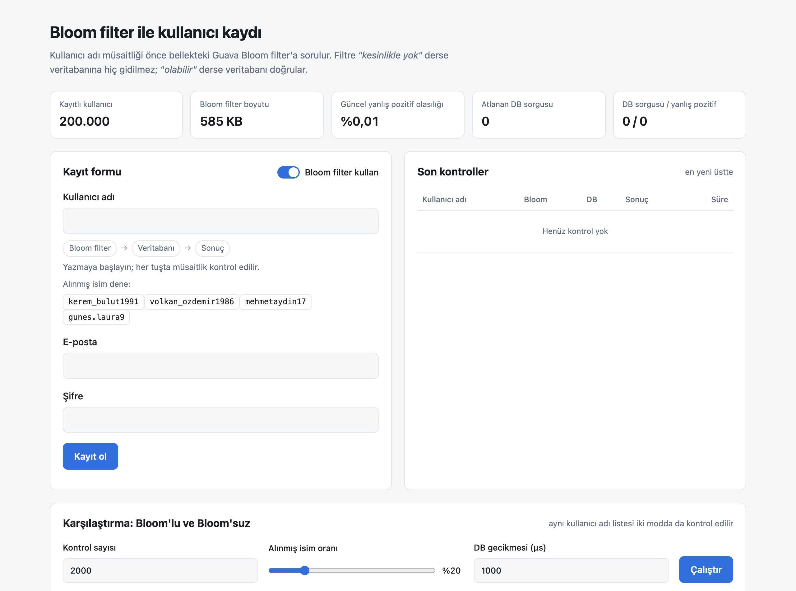
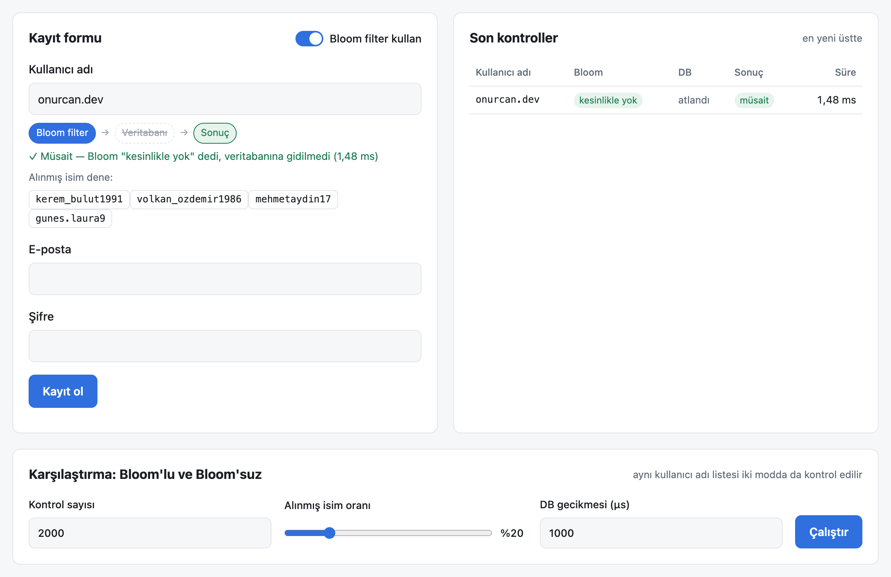
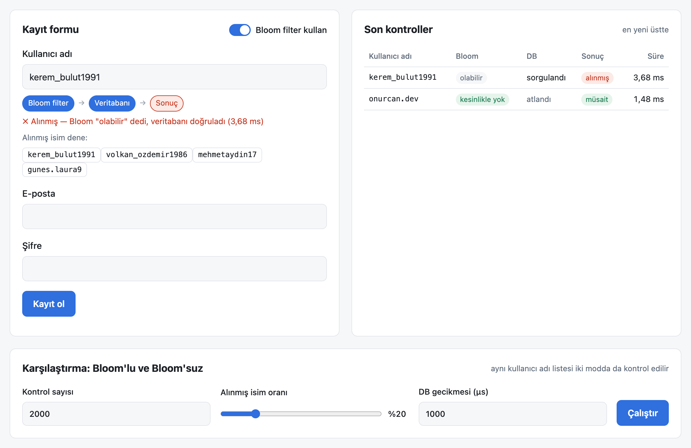
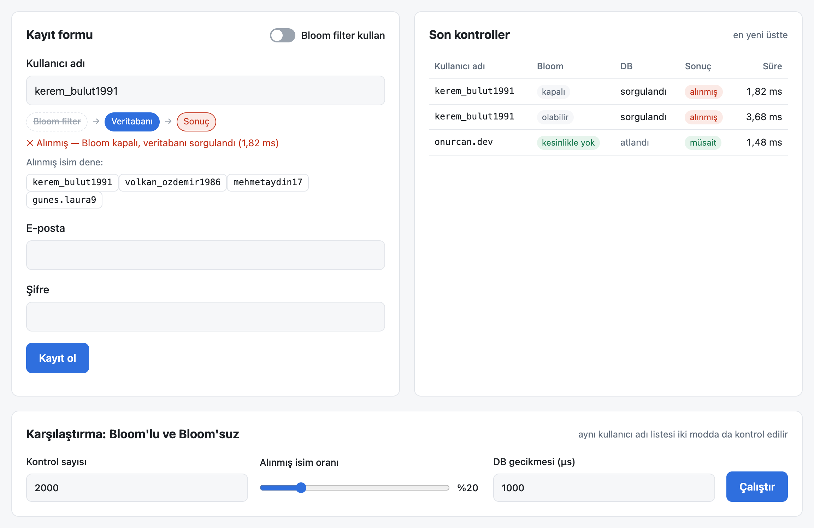
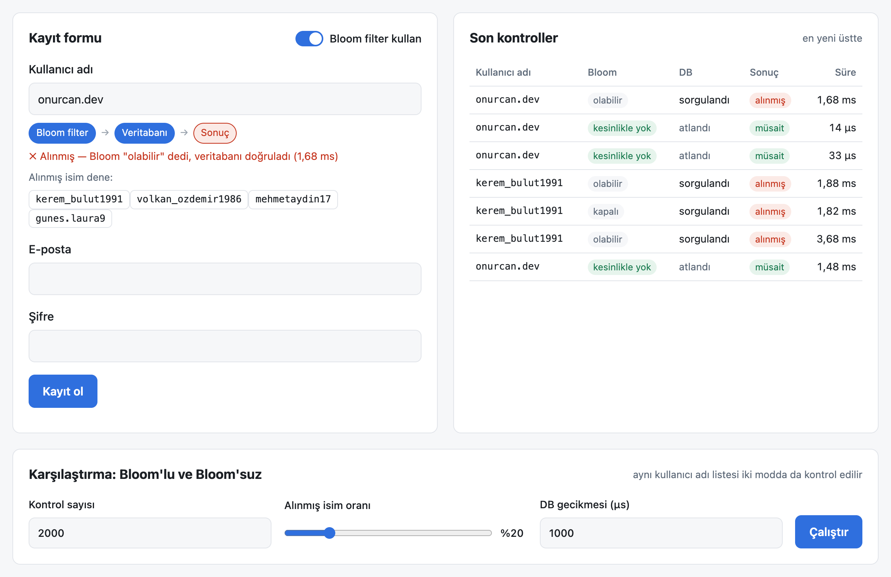
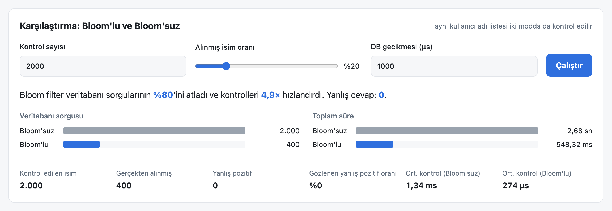
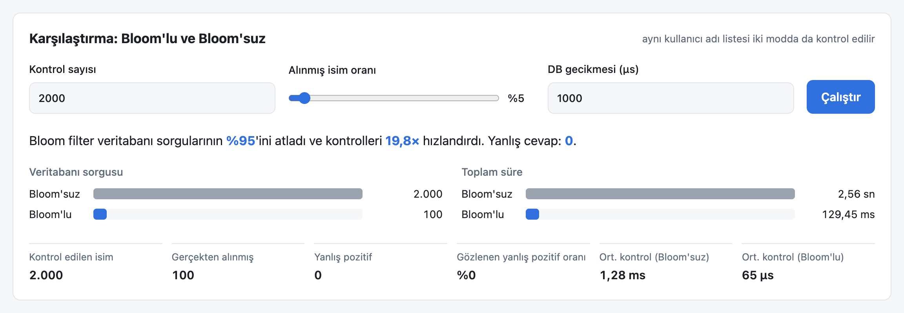
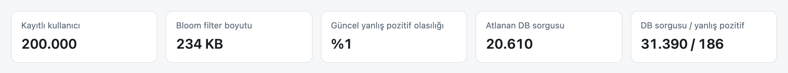
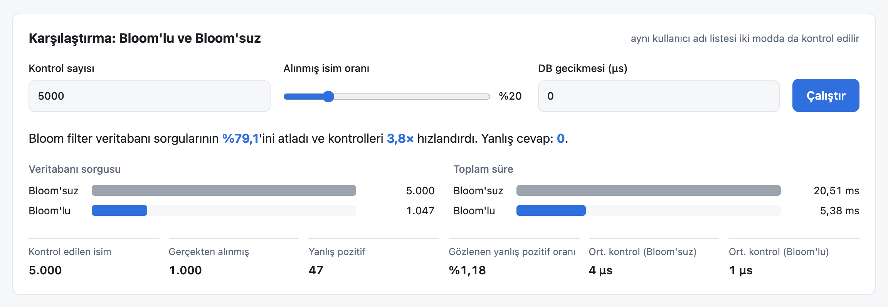

# Bloom Filter Registration

A user registration form where **username availability is checked through a Bloom filter
before the database is touched**. Built with Java 21, Spring Boot 3.5,
[Guava's `BloomFilter`](https://guava.dev/releases/33.0.0-jre/api/docs/com/google/common/hash/BloomFilter.html),
an H2 database, and a plain HTML/JS front end. On startup it loads **200,000 realistic mock users**
so the difference between "with filter" and "without filter" is measurable.

> The UI text is in Turkish; the code, API and this document are in English.



## How it works

```
username ──► Bloom filter ──"definitely not added"──► available      (no DB round trip)
                  │
                  └──"might have been added"──► DB lookup ──► taken / available (false positive)
```

A Bloom filter can say **"definitely not in the set"** or **"possibly in the set"**. It never gives a
false negative, so a "no" answer is safe to trust and the database is skipped. A "maybe" answer is
confirmed with a real lookup. The `UNIQUE` constraint on `users.username` is still the source of
truth, so a race between two registrations of the same name cannot slip through.

| Piece | Where |
| --- | --- |
| Filter: Guava `BloomFilter<String>`, warmed from the DB at startup, updated on every registration | [`UsernameBloomFilter`](src/main/java/com/example/bloom/registration/UsernameBloomFilter.java) |
| Check logic (filter, then DB) and registration | [`RegistrationService`](src/main/java/com/example/bloom/registration/RegistrationService.java) |
| Username lookups are counted and get a simulated network delay | [`UserRepository`](src/main/java/com/example/bloom/user/UserRepository.java), [`DatabaseLatencySimulator`](src/main/java/com/example/bloom/user/DatabaseLatencySimulator.java) |
| 200k deterministic mock users (`ayse.yilmaz`, `mehmetkaya42`, `e_demir1994`, ...) | [`MockUserGenerator`](src/main/java/com/example/bloom/seed/MockUserGenerator.java) |
| Same probe set run in both modes and compared | [`BenchmarkService`](src/main/java/com/example/bloom/benchmark/BenchmarkService.java) |

**Why simulate latency?** In-memory H2 answers in microseconds, but a production database sits on the
network and each lookup costs a round trip. `app.db.simulated-latency-micros` (default `1000` = 1 ms)
adds that cost to every username lookup. The benchmark panel lets you set it to `0` to see the
raw in-process difference too.

## Running

Requirements: JDK 21 and Maven.

```bash
mvn spring-boot:run
```

Open <http://localhost:8080>. Run the tests with:

```bash
mvn test
```

Useful settings in [`application.properties`](src/main/resources/application.properties):

| Property | Default | Meaning |
| --- | --- | --- |
| `app.seed.user-count` | `200000` | Mock users loaded at startup (`0` disables seeding) |
| `app.bloom.expected-insertions` | `500000` | Filter capacity. Past this point the false-positive rate climbs quickly |
| `app.bloom.false-positive-rate` | `0.01` | Target false-positive rate at full capacity |
| `app.db.simulated-latency-micros` | `1000` | Delay added to every username lookup |

### API

| Method | Path | Description |
| --- | --- | --- |
| `GET` | `/api/users/availability?username=&useBloom=true` | Live availability check and the path it took |
| `POST` | `/api/users?useBloom=true` | Register `{username, email, password}`. Returns `201`, `400` (validation) or `409` (taken) |
| `GET` | `/api/users/samples?count=5` | Random existing usernames |
| `GET` | `/api/stats` | Counters plus filter size and current false-positive rate |
| `POST` | `/api/benchmark` | `{lookups, takenRatio, latencyMicros}`: compares both modes |

## Walkthrough

### 1. A new username is answered by the filter alone



The filter returns *definitely absent* (`kesinlikle yok`), so the **Database** step is crossed out and no
query runs. The very first check took 1.48 ms only because the JVM was still cold. Later
filter-only checks take **14–33 µs**, as the log in step 4 shows.

### 2. A taken username goes through the filter to the database



For an existing name the filter can only say *might exist* (`olabilir`), so the database confirms
it. That costs a full round trip (≈1.8 ms with the 1 ms simulated latency).

### 3. With the filter turned off, every check hits the database



The toggle bypasses the filter (`kapalı`), so every keystroke is a database query, whether or not
the name exists.

### 4. Registering adds the name to the filter immediately



Reading the log from bottom to top, `onurcan.dev` is first *definitely absent* (14 µs, no DB), then
gets registered. Typed again, it immediately comes back *might exist → taken*, because
registration calls `filter.put(...)` right after the insert.

## Results

All numbers come from the benchmark panel or [`scripts/benchmark.py`](scripts/benchmark.py) against
200,000 seeded users, a filter sized for 500,000 at a 1% target rate (585 KB), on an Apple M3
laptop. Each run shuffles a fresh set of probes: existing usernames mixed with realistic new ones.
Every run is checked answer by answer against the database-only run, and **none returned a wrong
answer**.

### With 1 ms database latency (realistic remote DB)





| Probes | Share already taken | DB lookups without → with filter | Total time without → with | Speed-up |
| ---: | ---: | ---: | ---: | ---: |
| 2,000 | 5% | 2,000 → 101 (−95%) | 2,619 ms → 132 ms | **19.8×** |
| 2,000 | 20% | 2,000 → 400 (−80%) | 2,633 ms → 536 ms | **4.9×** |
| 2,000 | 50% | 2,000 → 1,000 (−50%) | 2,619 ms → 1,344 ms | **1.9×** |

The gain depends on **how many checked names are new**, because only those can skip the database.
That fits registration well: most names people type while picking a username are not taken. The
filter does nothing for names that do exist. Those always need the database.

> 1 ms requested latency measures as about 1.3 ms per lookup because of macOS timer granularity.
> Both modes run under the same conditions, so the comparison stays fair.

### With zero added latency (in-process H2 only)

| Probes | Share already taken | DB lookups without → with filter | Total time without → with | Speed-up |
| ---: | ---: | ---: | ---: | ---: |
| 2,000 | 20% | 2,000 → 400 | 5.6 ms → 1.4 ms | 4.1× |
| 20,000 | 20% | 20,000 → 4,001 | 76.6 ms → 18.4 ms | 4.2× |

Even against an in-memory database, a filter probe (~1 µs) is cheaper than a SQL query (~4 µs).

### Sizing trade-off: memory vs. false positives

Same 200,000 users, 20,000 probes with 20% taken, filter started with different
`app.bloom.expected-insertions`:

| Expected insertions | Filter size | Predicted FP rate | DB lookups (of 20,000) | False positives (observed) | Wrong answers |
| ---: | ---: | ---: | ---: | ---: | ---: |
| 1,000,000 | 1,170 KB | 0.000% | 4,000 | 0 (0.00%) | 0 |
| **500,000** (default) | **585 KB** | **0.007%** | **4,000** | **0 (0.00%)** | **0** |
| 200,000 (exactly full) | 234 KB | 0.996% | 4,134 | 134 (0.84%) | 0 |
| 100,000 (2× over) | 117 KB | 15.7% | 6,505 | 2,505 (15.66%) | 0 |
| 50,000 (4× over) | 59 KB | 67.8% | 14,815 | 10,815 (67.59%) | 0 |





The screenshots above come from the "exactly full" configuration. The predicted rate reaches 1%
(`%1`), and about 1% of new names turn out to be false positives: 47 of the 4,000 new names in this
run. The counters in the stats bar add up every run since startup, including the 20,000-probe run
from the table. Takeaways:

- **False positives cost performance, never correctness.** Even with a hopelessly overfilled filter
  (68% FP rate) there are zero wrong answers, because every "maybe" is confirmed by the database.
- **The observed rate matches the prediction.** Guava's `expectedFpp()` estimates it from how full the
  bit array is, and it agrees with the measured rate in every row.
- **Size for growth.** Once a filter goes past its capacity it degrades quickly. The default reserves
  room for 2.5× the seed data at 585 KB. Storing the same 200k usernames in a `HashSet<String>` would
  take roughly 20 MB (String + byte[] + hash node per entry).
- **Bloom filters cannot delete.** If usernames can be released (account deletion), rebuild the
  filter periodically from the database, or switch to a counting or cuckoo filter.

## Reproducing the screenshots

The screenshots were captured from the running app by driving headless Chrome over the DevTools
protocol:

```bash
"/Applications/Google Chrome.app/Contents/MacOS/Google Chrome" --headless=new --remote-debugging-port=9333 --user-data-dir=/tmp/bloom-chrome about:blank &
node --experimental-websocket scripts/capture-screenshots.mjs 9333 http://localhost:8080 docs/screenshots main
```

For images 08 and 09, start the app with `--app.bloom.expected-insertions=200000` and use the
`at-capacity` scenario.
